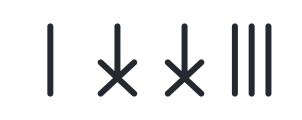
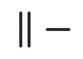
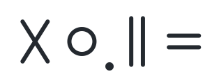
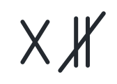
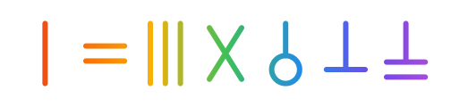
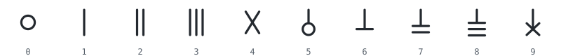

# suzhou-numerals

Render any number as [Suzhou numerals](https://en.wikipedia.org/wiki/Suzhou_numerals): SVG with zero dependencies, plus PNG, JPEG and WebP through [sharp](https://sharp.pixelplumbing.com/).

**[Docs and playground](https://karlnorling.github.io/suzhou-numerals/)** · [Storybook](https://karlnorling.github.io/suzhou-numerals/storybook/)

| Package                                                       | What it does                                     |
| ------------------------------------------------------------- | ------------------------------------------------ |
| [`@suzhou-numerals/core`](packages/@suzhou-numerals/core)     | Numbers to SVG. No dependencies, runs anywhere.  |
| [`@suzhou-numerals/raster`](packages/@suzhou-numerals/raster) | Numbers to PNG, JPEG or WebP in Node, via sharp. |
| [`@suzhou-numerals/cli`](packages/@suzhou-numerals/cli)       | The `suzhou` command.                            |

<p>
  
  
  
  
</p>
<p>
  
  
</p>

Suzhou numerals (蘇州碼子) are the shorthand that grew out of counting rods. Merchants used them on price tags, invoices and in traditional pharmacies, and they still turn up in Hong Kong markets. Zero is a circle, one to three are bars, four is a cross, and five to nine put an upright bar on top of the circle, the bars or the cross.



## Usage

```sh
npm install @suzhou-numerals/core
```

```js
import { toSvg } from '@suzhou-numerals/core';

const svg = toSvg(1993);
const red = toSvg(1993, { size: 200, color: '#c00', background: 'white' });
```

```sh
npm install @suzhou-numerals/raster
```

```js
import { toImage } from '@suzhou-numerals/raster';
import { writeFile } from 'node:fs/promises';

await writeFile('1993.webp', await toImage(1993, { format: 'webp', size: 400 }));
```

### Command line

```sh
npx @suzhou-numerals/cli 1993 > 1993.svg
npx @suzhou-numerals/cli 40.22 -o price.webp --size 200
npx @suzhou-numerals/cli -42 -o minus.png
```

Installed globally (`npm install -g @suzhou-numerals/cli`), the command is `suzhou`. Run `suzhou --help` for every option.

### Colours and gradients

`color` and `background` take any CSS colour, or a CSS gradient: `linear-gradient()`, `radial-gradient()` and their `repeating-` forms. A gradient spans the whole image.

```js
// Rainbow
toSvg('1234567', {
  color: 'linear-gradient(to right, #e03131, #f76707, #fab005, #40c057, #228be6, #7048e8, #be4bdb)',
});

// Christmas
toSvg('2026.1225', {
  color: 'repeating-linear-gradient(135deg, #e03131 0 3%, #ffffff 3% 6%)',
  background: 'radial-gradient(#2b8a3e, #0b3d20)',
});
```

## Numbers the Suzhou merchants didn't write

Suzhou numerals are decimal and positional, so whole numbers of any size need no extension. Writers used a few conventions that this library follows or replaces:

| Input   | Drawn as                    | Rule                                                                                                                    |
| ------- | --------------------------- | ----------------------------------------------------------------------------------------------------------------------- |
| `21`    | 〢一                        | In a run of 1s, 2s and 3s, every second one is written flat. `alternate: false` keeps them all upright.                 |
| `305`   | 〣〇〥                      | Zero is a circle.                                                                                                       |
| `40.22` | 〤〇, a dot, 〢一           | Price tags put the magnitude and unit on a second line (十元). This library marks the decimal point with a dot instead. |
| `-42`   | 〤〢 with a diagonal stroke | A stroke across the last digit, borrowed from the counting rods Suzhou numerals came from.                              |

The second line of a price tag, with its magnitude and unit in Chinese characters, isn't drawn. The dot and the negative stroke are modern additions.

Inputs can be a `number`, a `bigint` or a decimal `string`. A number is first written in its shortest exact form, so `0.1` draws as `0.1`. Strings and bigints keep every digit.

## API

### `toSvg(value, options?)` → `string` from `@suzhou-numerals/core`

| Option        | Default        | Notes                                                                                                   |
| ------------- | -------------- | ------------------------------------------------------------------------------------------------------- |
| `size`        | `100`          | Image height in pixels. The width follows from the number of digits.                                    |
| `color`       | `currentColor` | Stroke colour. Takes a colour or a gradient.                                                            |
| `background`  | none           | Colour or gradient behind the numeral.                                                                  |
| `gap`         | `12`           | Space between digits, in viewBox units.                                                                 |
| `padding`     | `20`           | Space around the numeral, in viewBox units.                                                             |
| `strokeWidth` | `5`            | Stroke width in viewBox units, where a digit is 60 tall.                                                |
| `alternate`   | `true`         | Turns every second 1, 2 or 3 in a run on its side, so 21 is 〢一 rather than 〢〡, which reads like 〣. |
| `title`       | the number     | Accessible name. `false` leaves it out and sets `aria-hidden`.                                          |

### `toImage(value, options?)` → `Promise<Buffer>` from `@suzhou-numerals/raster`

Takes every `toSvg` option, plus `format` (`png`, `jpeg`, `jpg` or `webp`; default `png`) and `quality` (1–100). Colours default to black. JPEG gets a white background unless you pass one.

### Lower level, from `@suzhou-numerals/core`

- `parse(value)` → `{ negative, integer, fraction }`: the base-10 digits that get drawn.
- `format(parsed)` → the canonical decimal string, e.g. `-12.5`.
- `digitSvg(digit, place?, options?)` → one digit on its own.
- `parseGradient(css)` → the object form of a CSS gradient string, or `undefined` for a plain colour.
- `flatDigits(digits)` → which digits to turn flat under the alternating rule.
- `digitStrokes(digit, flat?)` → the lines and circles of one digit, for drawing somewhere else.

## Development

```sh
yarn install
yarn test        # all packages, straight from source
yarn build       # core, then raster, then cli
yarn docs        # docs site with the playground, on localhost:4322
yarn storybook   # Storybook on localhost:6006
yarn examples    # regenerate examples/
```

## License

MIT
